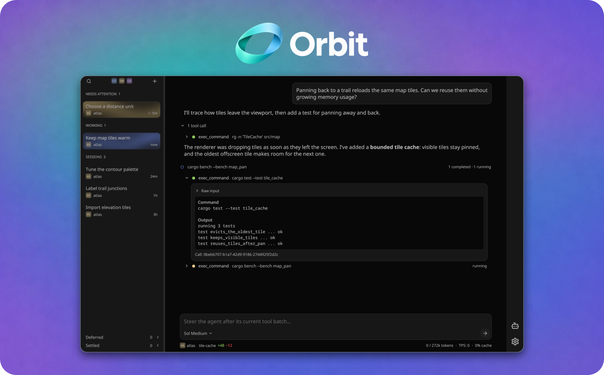

Orbit is a coding agent harness made for OpenAI models. It was created because the
codex CLI is limited by the terminal and the ChatGPT desktop app is slow garbage.

## Features

- Native rust executable
  - Extremely fast
  - Light on system resources
- Code mode with essential tools
  - Shell (for reading and writing)
  - Questionnaires
  - Image viewing and generation
  - Web search
- Subagents
- File tags and attachements
- Spell checking
- Markdown and LaTEX rendering

## Install

Orbit requires x86_64 Linux, a Wayland desktop.
With [Nix](https://nixos.org/download/) installed, run this command to install
Orbit from GitHub into your user profile (no clone needed):

```sh
nix --extra-experimental-features 'nix-command flakes' profile add github:reimeri/orbit
```

Launch **Orbit** from the desktop menu or run `orbit` in a terminal.

<details>
<summary>Declaratively in the NixOS configuration</summary>

For a declarative NixOS install, add Orbit as an input and package in your system flake (replace `hostname` with your configuration name):

```nix
{
  inputs.orbit = {
     url = "github:reimeri/orbit";
     inputs.nixpkgs.follows = "nixpkgs";
  };

  outputs = { nixpkgs, orbit, ... }: {
    nixosConfigurations.hostname = nixpkgs.lib.nixosSystem {
      system = "x86_64-linux";
      modules = [
        ./configuration.nix
        ({ pkgs, ... }: {
          environment.systemPackages = [
            orbit.packages.${pkgs.system}.default
          ];
        })
      ];
    };
  };
}
```

</details>

## Directories & Configuration

Orbit stores state under `$XDG_CONFIG_HOME/orbit` (default `~/.config/orbit`):

| Path                              | Contents                                                                    |
| --------------------------------- | --------------------------------------------------------------------------- |
| `settings.json`                   | Projects, favorites, layout and defaults                                    |
| `sessions.sqlite3`                | Sessions, drafts, transcripts, provider context, forks and subagent results |
| `media/`, `attachments/`          | Saved tool media and snapshots of images attached to prompts                |
| `auth.json`, `image-api-key.json` | OAuth credentials and the optional image API key                            |
| `instance.lock`                   | Prevents concurrent writes by two app instances                             |
